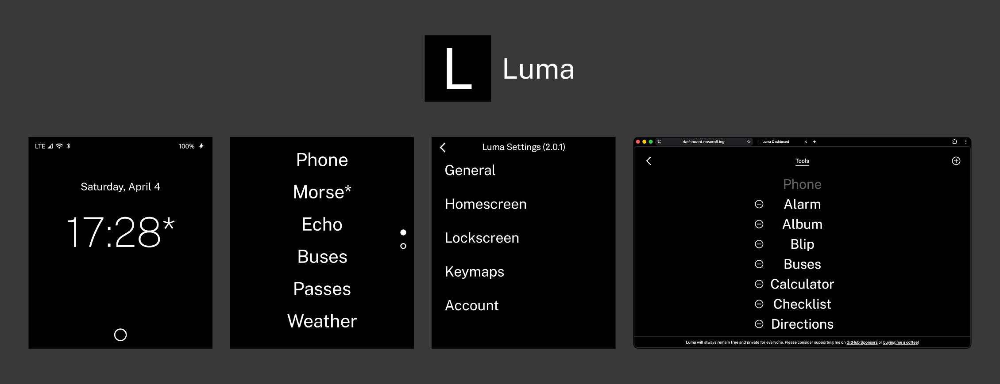

<p>A launcher for the Light Phone III.</p>


> [!NOTE]
> Luma is in active development and intended for users who have enabled `adb` on their device.
> 
> If you face any bugs, please submit an [issue](https://github.com/vandamd/luma/issues) or let me know via [Discord](https://discord.gg/CcnP8kREu6) in the `modding-and-hacking` channel.
> Luma can be restarted by long pressing the home button for ~10 seconds. You'll feel a haptic!

## Installation
The lastest .apk file is available in [releases](https://github.com/vandamd/luma/releases/latest).

## Getting Started
For Luma to work, you are prompted to grant various permissions during onboarding. These permissions allow Luma to display it's custom lockscreen, detect key presses, display notifications, change the brightness, install apps and more!

To avoid conflicts, the use of other keymapping apps is discouraged (e.g. Key Mapper).

It is expected that LightOS remains the default Phone, Home and SMS app, otherwise LightOS will crash.

For the best experience, the Display and Text size should remain default.

## Features
- Configurable tools via a web dashboard, ([dashboard.noscroll.ing](https://dashboard.noscroll.ing))
- Fingerprint compatible lock screen
- Key mapping (camera and scroll wheel, press and long press)
- Gestures (homescreen and lockscreen)
- Colour filter toggler

## For App Developers

### Claiming the scroll wheel
By default Luma uses the scroll wheel for brightness (turns) and the key mapping (presses) in every app. An app can claim the wheel while it is in front, so turns (key codes `317`/`318`) and presses (`319`) reach the app instead.

Send an explicit broadcast to Luma:

| | |
|---|---|
| Action | `com.vandam.luma.action.SCROLLWHEEL` |
| Package | `com.vandam.luma` (set with `Intent.setPackage`) |
| Extra `package` | `String`, your app's package name |
| Extra `claim` | `Boolean`, `true` to claim, `false` to release |

Claim in `onResume` and release in `onPause`:

```kotlin
private fun setLumaScrollwheelClaim(claim: Boolean) {
    sendBroadcast(
        Intent("com.vandam.luma.action.SCROLLWHEEL")
            .setPackage("com.vandam.luma")
            .putExtra("package", packageName)
            .putExtra("claim", claim),
    )
}

override fun onResume() {
    super.onResume()
    setLumaScrollwheelClaim(true)
}

override fun onPause() {
    setLumaScrollwheelClaim(false)
    super.onPause()
}
```

Notes:
- Only one app holds the claim. A release only clears it when it comes from the app that holds it.
- A claim only counts while that app is in front. Switching apps, returning to Luma or locking the phone gives the wheel back to Luma straight away.
- On the lock screen a claim only counts while that app's call screen is showing over it (supported call apps: WhatsApp Light and Molly), so a call can be answered with the wheel.
- No permission is needed. Luma must be running (its accessibility service enabled) to receive the broadcast.

To test from a computer, then watch `adb logcat -s LumaActionService` for `Scroll wheel claimed by …`:

```bash
adb shell am broadcast -a com.vandam.luma.action.SCROLLWHEEL -p com.vandam.luma --es package com.example.app --ez claim true
```

## Acknowledgements
Huge thank you to the following projects:
- Forked from: [OlauncherCF](https://github.com/OlauncherCF/OlauncherCF)
- Inspired by: [InkOS](https://github.com/gezimos/inkOS)

## Support
Luma is developed and maintained in my free time.

If you find it useful, please [consider sponsoring](https://github.com/sponsors/vandamd)! :)
